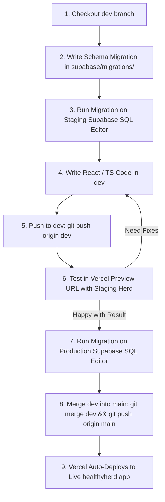

# HealthyHerd — Staging, Testing & Deployment Workflow

> **Purpose**: This document serves as the permanent playbook for development cycles, schema migrations, testing on Vercel Preview (Staging), and promoting features to Live Production.

---

## 1. Environment Architecture Quick Reference

| Environment | Git Branch | Vercel Domain | Supabase Project Ref | Supabase URL |
| :--- | :--- | :--- | :--- | :--- |
| **Production (Live)** | `main` | `healthyherd.app`<br/>`cattleapp-mauve.vercel.app` | `hpddjhajklbgxcqgbvzc` | `https://hpddjhajklbgxcqgbvzc.supabase.co` |
| **Staging (Preview)** | `dev` | `cattleapp-git-dev-daniebads-projects.vercel.app` | `wvlgzjmhabwcwmcisfve` | `https://wvlgzjmhabwcwmcisfve.supabase.co` |

### Staging Test Account
* **Email**: `djb.rsa@gmail.com`
* **Password**: `mS5DP84ad4h`
* **Farm**: *Rykwater* (has all 368 production animals, pastures, and health logs mirrored).

---

## 2. Vercel Environment Variables Configuration

In **Vercel Project Settings > Environment Variables**, variables must be scoped as follows:

| Variable Name | Environment Target | Type | Value / Purpose |
| :--- | :--- | :--- | :--- |
| `VITE_SUPABASE_URL` | **Production** | Config | `https://hpddjhajklbgxcqgbvzc.supabase.co` |
| `VITE_SUPABASE_ANON_KEY` | **Production** | Config | Live production anon key |
| `VITE_SUPABASE_URL` | **Preview (`dev`)** | Config | `https://wvlgzjmhabwcwmcisfve.supabase.co` |
| `VITE_SUPABASE_ANON_KEY` | **Preview (`dev`)** | Config | `sb_publishable_h3RiA09Dd9a8jvBLlKO8QA_pwCQuinW` |

> [!IMPORTANT]
> **Vercel Rule for `VITE_` Variables**: Any variable starting with `VITE_` MUST be configured as **Config** (not *Secret*), because it is bundled into client-side JavaScript.

---

## 3. Standard Feature Enhancement Lifecycle

Follow this cycle whenever building new features or modifying the database:



### Step 1: Branch & Migration
1. Ensure you are on the `dev` branch:
   ```bash
   git checkout dev
   git pull origin dev
   ```
2. If adding fields/tables, create a new SQL file in `supabase/migrations/`:
   ```sql
   -- Name format: YYYYMMDDHHMMSS_description.sql
   ALTER TABLE public.farm_settings 
     ADD COLUMN IF NOT EXISTS farmer_address text;
   ```
   *(Always use `IF NOT EXISTS` and default values to prevent breaking existing rows).*

### Step 2: Apply to Staging Database ONLY
1. Go to the [Supabase Dashboard](https://supabase.com/dashboard) and select **HealthyHerd-Staging** (`wvlgzjmhabwcwmcisfve`).
2. Open the **SQL Editor** and execute the new migration SQL.
3. Update [types.ts](file:///Users/daniebadenhorst/CattleApp/src/types.ts) and local Dexie schema in [src/database/db.ts](file:///Users/daniebadenhorst/CattleApp/src/database/db.ts) if applicable.

### Step 3: Develop & Test in Preview
1. Commit your changes:
   ```bash
   git add .
   git commit -m "feat(herd): add farmer address field"
   git push origin dev
   ```
2. Vercel automatically builds a Preview deployment at:
   👉 **`https://cattleapp-git-dev-daniebads-projects.vercel.app`**
3. Log in with your staging test user (`djb.rsa@gmail.com`) and test the new UI and data flow against your cloned staging herd.
4. Any mutations or test records stay **100% isolated** in Staging—live production data is unaffected.

### Step 4: Promote to Production (Zero Test Data Pollution)
Once testing is complete and approved:
1. **Apply Migration to Production**:
   Open **Production Supabase** (`hpddjhajklbgxcqgbvzc`) > **SQL Editor**, and execute the exact same migration SQL.
   *(Since new columns default to NULL or default values, existing live production animals/records remain completely intact).*
2. **Merge & Push to `main`**:
   ```bash
   git checkout main
   git pull origin main
   git merge dev
   git push origin main
   ```
3. Vercel automatically deploys `main` to **`healthyherd.app`**.
4. The live production app now has the new code and fields, with zero test data added!

---

## 4. How to Refresh Staging with Fresh Production Data

If you ever need to overwrite Staging with the latest live production herd data again in the future:

1. A sync script can be executed using the Supabase service role keys.
2. The sync process:
   - Temporarily disables the animal quota trigger on Staging (`ALTER TABLE public.animals DISABLE TRIGGER enforce_animal_limit;`).
   - Copies `camps`, `farm_settings`, and `subscriptions`.
   - Inserts `animals` using a two-pass approach (first base animals, then links `sire_id` / `dam_id`).
   - Copies `health_logs`, `weight_logs`, `movement_log`, `journal_logs`, and `sale_records`.
   - Re-enables the animal limit trigger (`ALTER TABLE public.animals ENABLE TRIGGER enforce_animal_limit;`).
3. Set the staging user password for `djb.rsa@gmail.com` to your preferred testing password.

---

## 5. Troubleshooting & Gotchas

### Issue 1: Vercel intercepts with a login screen asking for SSO / SAML
* **Cause**: Vercel "Deployment Protection" is enabled on Preview builds.
* **Fix**: Vercel Dashboard > **cattleapp** > **Settings** > **Deployment Protection** > turn **Vercel Authentication** to **Disabled**.

### Issue 2: Preview says "User not found" or "Invalid login credentials"
* **Cause**: The preview environment variables might be pointing to a different Supabase project or Production.
* **Fix**: Verify `VITE_SUPABASE_URL` in Preview is `https://wvlgzjmhabwcwmcisfve.supabase.co`. Make sure you redeploy after changing variables!

### Issue 3: Animal limit reached error during bulk import
* **Cause**: The database trigger `enforce_animal_limit` checks subscription plan limits.
* **Fix**: Ensure `subscriptions` table is updated before inserting animals, or temporarily disable the trigger during bulk sync.
